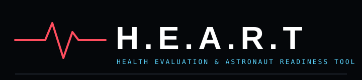
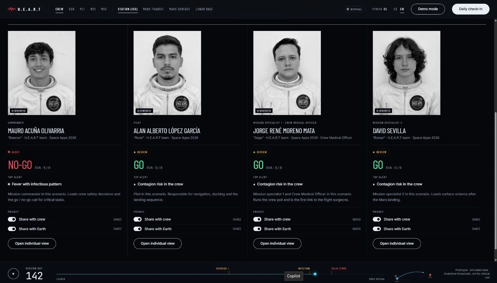
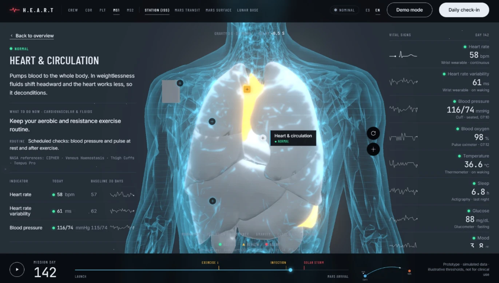
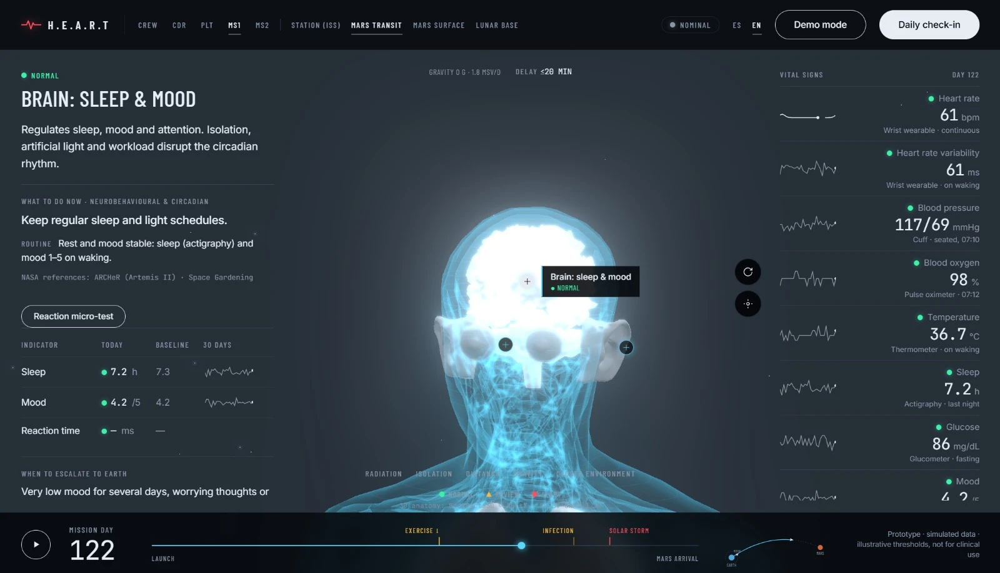

<p align="center"></p>

<p align="center">
<b>NASA Space Apps Challenge 2026</b> · <i>Create Health Monitoring Software for Astronauts on Space Missions</i><br><br>
<a href="https://mauspaces.github.io/heart-space-apps/"></a>


</p>

<p align="center"><a href="#the-problem">Problem</a> · <a href="#what-it-does">Features</a> · <a href="#try-it">Run</a> · <a href="#demo-script-about-two-minutes">Demo</a> · <a href="#nasa-data-and-resources">NASA data</a> · <a href="#use-of-ai">Use of AI</a></p>

<p align="center"><b>Live app: <a href="https://mauspaces.github.io/heart-space-apps/">https://mauspaces.github.io/heart-space-apps/</a></b></p>



*Prototype · simulated data · illustrative thresholds · not for clinical use. The crew is played by the four of us. No real astronaut's name, photo or likeness appears, and every health value is simulated.*

## The problem

A radio message between Mars and Earth takes up to about 20 minutes one way, so a question and its answer can take far longer. On a Mars mission nobody on the ground can help in real time. The crew has to understand its own health on board and decide what to do.

H.E.A.R.T is a small console for that situation. It runs offline in the browser, reads (simulated) daily measurements, and tells an astronaut what changed compared with their own normal, why it matters, and what to do next.

## What it does

- **Compares you with yourself.** Each person's baseline is their own days 1–14, not a population average.
- **Looks at patterns, not single numbers.** NASA describes spaceflight hazards as feeding each other, so the engine combines indicators. Lower HRV, shorter sleep and a rising temperature together raise a possible early infection, before fever shows up.
- **Body hologram.** A 3D body whose organs change colour with their status. Tap an organ to see what it does, today against baseline, a 30-day trend, what to do now and when to call Earth.
- **Readiness for a critical task.** An EVA score (Ready / Review / Not fit) per person.
- **Crew view** for the Crew Medical Officer: a go / no-go board, the top alert of each person, a contagion alert when someone has fever, and per-person switches for sharing data with the crew or with Earth.
- **Radiation.** Cumulative dose against the 600 mSv career limit, and a solar-storm overlay with a countdown and a four-step shelter checklist.
- **Medical packet to Earth** that shows the communication delay of the selected environment (ISS, Mars transit, Mars surface, Lunar base).
- **Daily check-in, on-board self-tests** (Amsler grid, reaction time), a mission timeline from day 1 to 180, and an Earth–Moon–Mars mini-map.
- **Demo mode** that plays our two-minute pitch inside the real app.

Alerts are deterministic and rule-based, so every one can be traced to the numbers behind it. No generative AI makes medical decisions. Status is never shown by colour alone (● normal, ▲ review, ◆ alert, always with text).





## Try it

Requires Node.js 18+.

```bash
npm install
npm run dev        # http://localhost:5173
npm run build      # static site in dist/
npm run preview    # serve the production build
```

The build is a static site: no backend, no accounts, no external requests, and fonts are bundled. After the first load a service worker lets it run offline.

Deploy: push to `main` and the GitHub Pages workflow in `.github/workflows/pages.yml` publishes it (set *Settings → Pages → Source: GitHub Actions* once). Netlify also works: build `npm run build`, publish `dist`.

## Demo script (about two minutes)

Press **Demo mode** in the top bar.

1. Crew view, day 130: four personal baselines, everyone normal.
2. Commander's view, day 130: no alerts.
3. Day 139: early-infection pattern, before fever.
4. Day 142: fever, readiness drops to Not fit, contagion alert for the crew.
5. Day 151: solar storm, countdown and shelter checklist for everyone.
6. Mars surface: gravity-transition protocol for the partner-agency specialist.
7. Medical packet to Earth with the delay shown.

## How it is built

Vite and vanilla ES modules. The 3D body uses Three.js with a model derived from BodyParts3D (see credits), compressed to a 690 KB GLB by `scripts/build-anatomy.mjs`. A procedural body shows while it loads, and a Canvas 2D point-cloud version is the fallback without WebGL. The data comes from a seeded generator with one series per crew member. A small hand-written service worker handles offline use. Fonts (Barlow Condensed, JetBrains Mono, Inter) come from Fontsource under the SIL OFL.

The code map is in [`CLAUDE.md`](CLAUDE.md), design tokens in [`docs/design/`](docs/design), and our research notes (in Spanish) in [`docs/brain/`](docs/brain).

## NASA data and resources

The thresholds built on these are illustrative.

| Resource | How we used it |
|---|---|
| NASA HRP, Five Hazards of Human Spaceflight | Hazard filters on the hologram and the reason alerts combine indicators. |
| NASA HRP, Risks of Human Spaceflight | Links organs and indicators to HRP risks (immune, cardiovascular, sensorimotor, bone, behavioural health, sleep, SANS, radiation). |
| ARCHeR | Precedent for wrist actigraphy, crew-interaction questions and measuring against a personal baseline. |
| Immune Biomarkers (Artemis II) | Stress–immunity link and the symptom checklist. |
| Artemis II Standard Measures | Balance test, strength measure and the readiness-for-a-task idea. |
| Curiosity RAD dose rates | 1.8 mSv/day in transit and 0.67 mSv/day on the Mars surface. |
| NASA career radiation limit (600 mSv), 250 mSv short-term figure | Cumulative-dose gauge, projection and solar-event alert. |
| CSA CANS (partner agency) | Model for the on-board dosimeter behind the radiation module. |

Sources are listed in [`docs/brain/Cerebro-SpaceApps-2026/Fuentes.md`](docs/brain/Cerebro-SpaceApps-2026/Fuentes.md). NASA does not endorse this project, and no NASA logo, seal or mission patch is used.

## Use of AI

The application code was written with AI assistance. We used Claude Code (Anthropic) to port our first single-file prototype to modules and to build the crew model, crew view, contagion and privacy logic, demo mode, mini-map, offline support, the 3D body and the visual design, with us directing and reviewing. We prepared the research notes and product concept with AI help and checked them against the NASA and CSA pages above.

The crew portraits are our own photos edited with Higgsfield (AI image generation) into spacesuit portraits. Each one carries a visible "AI-generated" mark in the app and in the screenshots above. Any other AI-made artwork in our slides is marked the same way.

## Roadmap

Analog missions (CHAPEA-like), then Artemis lunar missions, a lunar base, and Mars.

## Credits and licences

Code is shared for the competition entry. Fonts are under the SIL Open Font License via Fontsource.

The 3D anatomy (`public/models/anatomy.glb`) is derived from BodyParts3D, © The Database Center for Life Science (DBCLS), licensed under [CC BY-SA 2.1 Japan](https://creativecommons.org/licenses/by-sa/2.1/jp/deed.en). Source meshes come from the STL copies at [github.com/Kevin-Mattheus-Moerman/BodyParts3D](https://github.com/Kevin-Mattheus-Moerman/BodyParts3D). We merged, simplified, re-oriented and compressed them, and share the derived model under the same licence.
